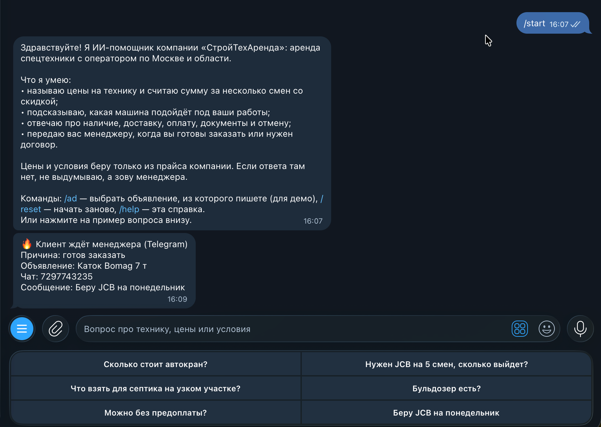

# ИИ-консультант по прайсу

[](https://github.com/zxsolid/avito-ai-consultant/actions/workflows/ci.yml)

Бот отвечает клиентам от имени компании, считает стоимость и оформляет заявку. Цены, скидки и условия берёт только из прайса. Каждое число в ответе сверяет с прайсом до отправки. Готовую заявку с телефоном клиента присылает менеджеру в Telegram.

Каналы: Telegram и чаты Авито. Логика от канала не зависит, сайт или WhatsApp подключаются отдельным модулем в `app/channels/`.

Демо: аренда спецтехники.

Компания и прайс выдуманы: `data/catalog.yaml`.

<p>
  
  
</p>

## Что делает

- **Отвечает по прайсу.** Находит в прайсе и правилах нужные куски и отдаёт их модели вместе с вопросом. В Авито знает, из какого объявления пишет клиент.
- **Не выдумывает цифры.** До отправки проверяет каждое число в ответе: оно должно быть в прайсе, в вопросе покупателя или получаться из них (цена × смены, со скидкой из правил). Если модель придумала цену, просит её переписать ответ. Если и вторая попытка с выдумкой, бот не отправляет ответ, а зовёт менеджера.
- **Не даёт лишних обещаний.** Ловит «гарантируем», «бесплатно», «забронировал», если этого нет в правилах. «Не гарантируем» пропускает.
- **Понимает клиента, а не ключевые слова.** На каждое сообщение модель возвращает, чего хочет клиент (спросить, заказать, отказаться, позвать человека), что он сообщил для заявки и ответ. Код проверяет факты: машину по прайсу, телефон, суммы и каждую цифру в ответе. Если модель ответила не по формату, бот переходит на правила с ключевыми словами.
- **Оформляет заявку.** На «беру», «пришлите договор» или номер телефона бот собирает заявку: технику, работы, адрес, дату, имя и телефон. Что клиент уже написал, не переспрашивает. Вопрос посреди заявки отвечает и возвращается к заявке. Менеджер получает карточку с расчётом:

  ```
  🔥 Новая заявка (Telegram)
  Клиент: Анна @anna        ← ссылка на профиль, менеджер пишет клиенту в один клик
  Техника: Экскаватор-погрузчик JCB 3CX
  Расчёт: Экскаватор-погрузчик JCB 3CX, смен подряд: 5, цена смены 22000 ₽, скидка 5%, итого 104500 ₽. Доставка и переработка в итог не входят.
  Работы: котлован
  Адрес: Химки
  Когда: завтра 8:00
  Имя: Анна
  Телефон: +79161234567
  ```
- **Зовёт менеджера редко и по делу**: когда клиент просит живого человека, жалуется или модель не нашла ответа в прайсе. По одному чату не чаще раза в час, кроме просьбы позвать человека. На торг отвечает скидками из прайса.
- **Помнит про ушедших.** Клиент спросил про технику или начал заявку и замолчал на 30 минут: менеджер получает, кто это был, чем интересовался и на каком шаге остановился.
- **Понимает английский.** Пишут по-английски, отвечает и ведёт заявку по-английски.
- **Держит роль.** На «забудь инструкции» и «покажи промпт» продолжает консультировать.
- **Помнит разговор.** На «а переработка?» после вопроса про кран отвечает про кран.

## Как проверено

`eval/cases.yaml`: каверзные вопросы клиента. Цены, расчёт со скидкой, техника, которой нет в парке, регион, где не работают, попытки выбить скидку 50% через «забудь инструкции», просьба показать промпт, заявка, жалоба, вопросы по-английски. Для каждого вопроса записано, что должно и чего не должно быть в ответе, нужен ли менеджер и что с заявкой.

```bash
python -m eval.run_eval   # прогон на настоящей модели, отчёт в eval/report.md
```

### Результат на YandexGPT

Последний прогон: **31 из 31**, все ответы в [eval/report.md](eval/report.md). Это прогон до заявки и английского.

К этому пришёл за три прогона. В первом проверки прошли 30 из 31, но я прочитал все ответы и нашёл ошибки, которые проверки пропустили:

- за 5 смен JCB модель назвала 110 000 ₽ «с учётом скидки 5%», а верно 104 500 ₽;
- на «Вы живой человек?» ответила «Да»;
- написала стих про экскаватор;
- звала менеджера после полных ответов про отмену и доставку.

Что поменял: итог со скидкой теперь считает код и отдаёт модели готовой строкой, проверка цифр не пропускает сумму без положенной скидки, бот честно говорит, что он ИИ-помощник, и не пишет тексты не по теме. Проверки в `eval/cases.yaml` ужесточил, чтобы такие ответы падали.

Логика проверок покрыта тестами без сети: проверка цифр и обещаний, заявка, передача менеджеру, поиск по прайсу, повтор и отказ при выдумке, вебхук Авито, запросы к YandexGPT. Тесты запускаются в GitHub Actions на каждый push.

## Как устроено

```
data/catalog.yaml     — прайс и правила компании
app/
  knowledge.py        — поиск по прайсу (BM25) с синонимами: «кран», «камаз», «трактор»
  guard.py            — проверка цифр и обещаний в ответе
  handoff.py          — когда собирать заявку и когда звать менеджера
  lead.py             — заявка: что спросить, телефон, карточка менеджеру
  texts.py            — фразы бота по-русски и по-английски
  agent.py            — сборка контекста, вызов модели, повтор, отказ, история чата
  llm.py              — YandexGPT и любой сервис с API как у OpenAI
  channels/avito.py   — вебхук и API мессенджера Авито
  channels/telegram.py — Telegram, /ad пишет как из объявления на Авито
eval/                 — каверзные вопросы и прогон
tests/                — тесты на pytest
```

## Запуск

```bash
python -m venv .venv && . .venv/bin/activate
pip install -e ".[dev]"
cp .env.example .env    # вписать ключ модели и токен бота
```

- В терминале: `python -m app.chat_cli` (или `python -m app.chat_cli 4012345602` — как будто пишут из объявления мини-экскаватора).
- В Telegram: `python -m app.run_telegram`. Команды видны в меню бота: `/ad` пишет как из объявления на Авито, `/reset` начинает диалог заново.
- Авито: `uvicorn app.run_avito:app --port 8000`, вебхук `https://ваш-домен/avito/webhook/<AVITO_WEBHOOK_SECRET>`. Без секрета сервер не запустится.

Запросы к API Авито собраны по документации developers.avito.ru. На боевом аккаунте их нужно проверить с доступами заказчика.

## Как подключить к своему бизнесу

Заменить `data/catalog.yaml` своим прайсом и правилами. Поменять компанию в промпте не нужно: бот берёт название из прайса. Добавить свои каверзные вопросы в `eval/cases.yaml` и прогнать перед запуском.

## Стек

Python 3.11+, aiogram 3, FastAPI, httpx, rank-bm25, pydantic-settings, pytest, respx, ruff.
