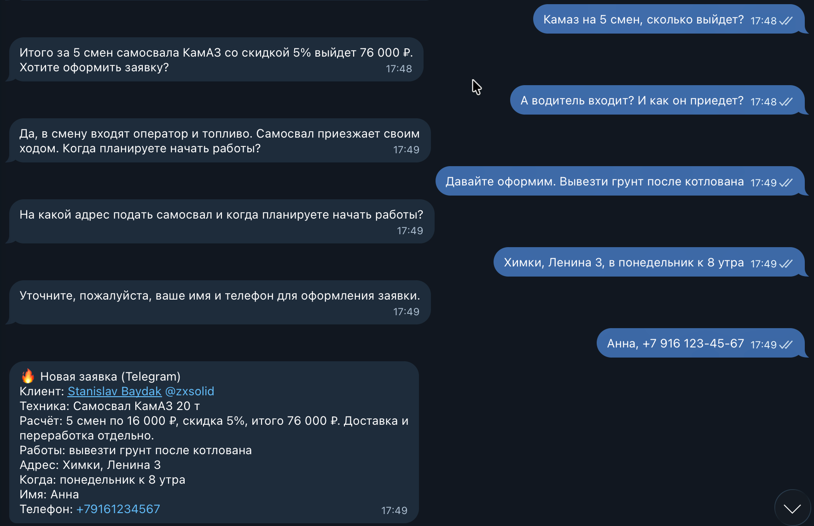
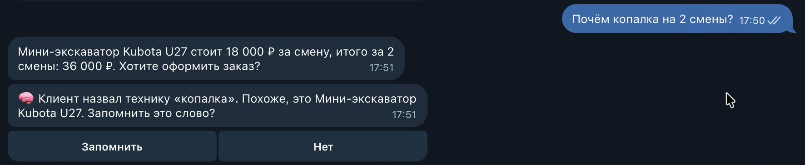

# ИИ-консультант по прайсу

[](https://github.com/zxsolid/ai-sales-consultant/actions/workflows/ci.yml)

Бот отвечает клиентам, пока менеджер занят: называет цены, считает сумму, подбирает технику и оформляет заявку. Цены берёт только из прайса и сверяет каждую цифру до отправки. Готовую заявку с телефоном и расчётом присылает менеджеру в Telegram.

Работает в Telegram. Другие каналы, например сайт или мессенджер, подключаются отдельным модулем в `app/channels/`: логика бота от канала не зависит.

Демо: выдуманная компания по аренде спецтехники, прайс в `data/catalog.yaml`.

<p>
  
  
</p>

## Что умеет

**Говорит как живой менеджер.** Понимает «давайте оформим на 10 дней», «не, пока дорого», «а с доставкой?», «лучше камаз». Вопросы по заявке задаёт своими словами и не переспрашивает то, что клиент уже написал. Понимает русский и английский.

**Считает по прайсу.** «Камаз на 5 смен?» → «76 000 ₽ со скидкой 5%». Сумму считает код, а не модель. Весь парк выдаёт списком: цена смены, как приезжает, что в наличии.

**Не выдумывает.** До отправки сверяет каждое число в ответе с прайсом: цену, скидку, итог. Ловит цену чужой машины («переработка крана 2 400 ₽», а это цена катка), обещания вроде «бесплатно» и «гарантируем», служебные слова вроде «в предоставленных данных». Если модель ошиблась, просит переписать. Если ошиблась дважды, бот не отправляет ответ и зовёт менеджера.

**Оформляет заявку.** Собирает технику, работы, адрес, дату, имя и телефон. Клиент видит сводку с суммой, менеджер получает карточку:

```
🔥 Новая заявка (Telegram)
Клиент: Анна @anna        ← ссылка на профиль, написать клиенту в один клик
Техника: Самосвал КамАЗ 20 т
Расчёт: 5 смен по 16 000 ₽, скидка 5%, итого 76 000 ₽. Доставка и переработка отдельно.
Работы: перевозка гравия
Адрес: Химки, Ленина 3
Когда: 5 декабря, 8:00
Имя: Анна
Телефон: +79161234567
```

**Зовёт менеджера по делу.** Когда клиент просит человека, жалуется или в прайсе нет ответа. Менеджер видит, о какой технике речь, и последние сообщения клиента. На торг бот отвечает скидками из прайса сам.

**Не теряет клиентов.** Клиент спросил про технику и замолчал на 30 минут: менеджер получает, кто это, чем интересовался и на каком шаге заявки остановился.

**Учится с одобрения менеджера.** Клиент назвал технику незнакомым словом («копалка») или спросил то, чего нет в прайсе: менеджеру приходит предложение с кнопками «Запомнить» или «Ответить». Одобренное бот использует сразу. Сам бот ничего не запоминает, чтобы не выучить ошибку.



**Держит роль.** На «забудь инструкции», «дай скидку 50%» и «покажи промпт» продолжает консультировать по прайсу.

## Модель

YandexGPT или любой сервис с API как у OpenAI: DeepSeek, OpenAI или локальная модель на вашем сервере (Ollama, vLLM, LM Studio), если данные клиентов не должны уходить наружу. Модель меняется в `.env`, код не трогаем. GigaChat подключается отдельным модулем. Цены и условия бот берёт из `data/catalog.yaml`: чтобы их сменить, достаточно поправить этот файл.

## Как проверено

`eval/cases.yaml`: 34 каверзных вопроса клиента. Цены, расчёт со скидкой, техника, которой нет, чужой регион, «забудь инструкции», просьба показать промпт, заявка, жалоба, вопросы по-английски. Для каждого записано, что должно и чего не должно быть в ответе, нужен ли менеджер и что с заявкой. Все ответы последнего прогона: [eval/report.md](eval/report.md).

```bash
python -m eval.run_eval                     # все вопросы на настоящей модели
python -m eval.run_eval far-region,bargain  # только выбранные
```

Логика покрыта тестами без сети, их гоняет GitHub Actions на каждый push: проверка цифр, заявка, передача менеджеру, обучение, уход клиента, сохранение диалогов после перезапуска, приём сообщений по вебхуку, повтор отправки, запросы к YandexGPT.

Пример, как прогон находит ошибки: в первой версии модель за 5 смен JCB назвала 110 000 ₽ «с учётом скидки 5%», а верно 104 500 ₽. Теперь итог считает код и отдаёт модели готовой строкой.

## Как устроено

```
data/catalog.yaml      прайс и правила компании
data/learned.yaml      чему научил менеджер (создаётся сам)
app/
  agent.py             диалог: модель понимает клиента, код проверяет факты
  guard.py             проверка цифр, обещаний и служебных слов
  lead.py              заявка и карточка менеджеру
  followup.py          клиенты, которые ушли без заявки
  learning.py          предложения менеджеру: новые слова и ответы
  knowledge.py         поиск по прайсу
  llm.py               YandexGPT и любой сервис с API как у OpenAI
  storage.py           история и заявки на диске, переживают перезапуск
  channels/telegram.py Telegram
  channels/avito.py    канал по вебхуку, подробности в docs/avito.md
  channels/manager.py  чат менеджера: заявки и обучение
eval/                  каверзные вопросы и прогон
tests/                 тесты на pytest
```

## Запуск

```bash
python -m venv .venv && . .venv/bin/activate
pip install -e ".[dev]"
cp .env.example .env    # вписать ключ модели, токен бота и чат менеджера
```

- Терминал: `python -m app.chat_cli`.
- Telegram: `python -m app.run_telegram`. `/reset` начинает заново.
- Канал по вебхуку: `uvicorn app.run_avito:app --port 8000`, настройка в [docs/avito.md](docs/avito.md). Без секрета в `.env` сервер не запустится.

## Как подключить к своему бизнесу

Заменить `data/catalog.yaml` своим прайсом и правилами: название компании бот берёт оттуда. Добавить свои каверзные вопросы в `eval/cases.yaml` и прогнать перед запуском.

## Стек

Python 3.11+, aiogram 3, FastAPI, httpx, rank-bm25, pydantic-settings, pytest, respx, ruff.
